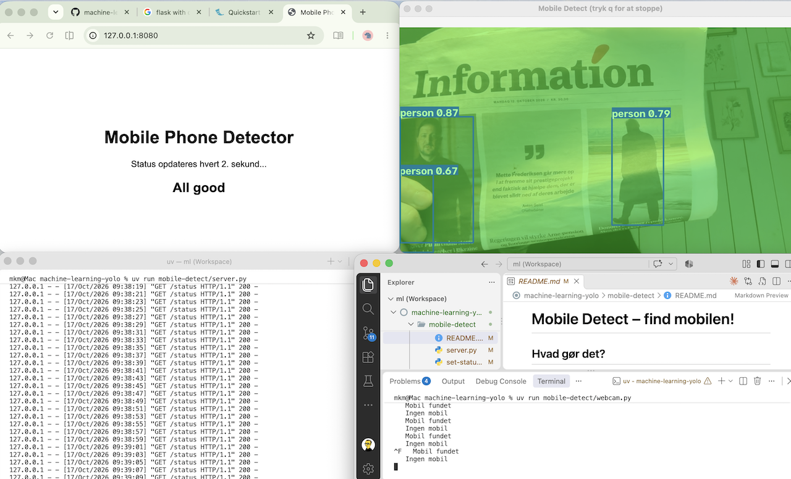
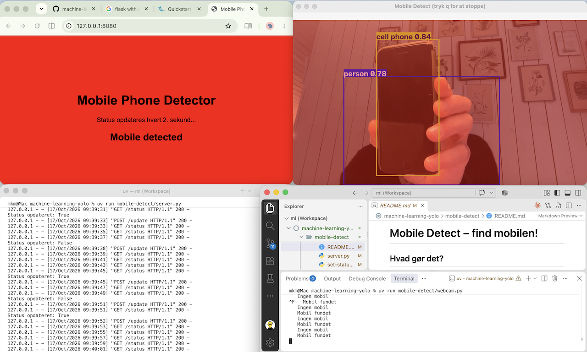

# Mobile Detect – find mobilen!

## Hvad gør det?

Mobile Detect holder øje med, om der er en **mobiltelefon** i billedet fra dit webcam.

- Webcam-vinduet viser kasser omkring det, YOLO ser, og bliver **grønt**, når den ser en person, og **rødt**, når den ser en mobil.
- Samtidig skifter en **hjemmeside** farve: **rød** ved "Mobile detected" og **hvid** ved "All good".

Hjemmesiden kan vises på en anden skærm – fx på projektoren i klassen.

| Ingen mobil | Mobil fundet |
|---|---|
|  |  |

## Hvordan virker det?

Projektet består af to små programmer, der snakker sammen:

1. **`webcam.py` – øjnene.** Henter billeder fra webcam og spørger YOLO: *"Hvad kan du se?"* YOLO kender 80 slags ting (personer, kopper, mobiler …), fordi den er trænet på tusindvis af billeder. Når YOLO har set (eller ikke set) en mobil i nogle billeder i træk, sender programmet en besked til serveren.
2. **`server.py` – hjemmesiden.** En lille webserver (lavet med Flask), som husker den seneste status og viser den på en hjemmeside. Siden spørger serveren hvert 2. sekund: *"Er der en mobil?"*

```
webcam  →  webcam.py + YOLO  →  besked: "mobil: ja/nej"  →  server.py  →  hjemmeside (rød/hvid)
```

Der er også to hjælpeprogrammer:

- **`find-camera.py`** – finder ud af, hvilket nummer dit kamera har.
- **`set-status.py`** – ændrer farven på hjemmesiden i hånden, så du kan teste serveren uden webcam.

## Installation med uv

Mobile Detect er en del af projektet `machine-learning-yolo`. Har du fulgt [installationsguiden](../README.md), er alt allerede klar.

Ellers: åbn en terminal i mappen `machine-learning-yolo` (ikke i `mobile-detect`) og kør:

```powershell
uv sync
```

Så installerer uv YOLO, OpenCV, Flask og de andre biblioteker, projektet bruger.

## Sådan kører du det

Du skal bruge **to terminaler** – én til serveren og én til webcam. Begge skal stå i mappen `machine-learning-yolo`.

> I VS Code: **Terminal → New Terminal** to gange, eller klik på **+** i terminalvinduet.

**Terminal 1 – start serveren:**

```powershell
uv run mobile-detect/server.py
```

I terminalen står der nogle adresser, fx:

```
 * Running on http://127.0.0.1:8080
 * Running on http://192.168.1.89:8080
```

Åbn **http://127.0.0.1:8080** i din browser. Den anden adresse kan bruges fra en anden computer eller telefon på samme netværk (det virker ikke altid på skolens netværk).

**Terminal 2 – start webcam:**

```powershell
uv run mobile-detect/webcam.py
```

Første gang hentes YOLO-modellen `yolo26n.pt` (ca. 5 MB). Så åbner webcam-vinduet. Hold en mobil op foran kameraet, og se hjemmesiden skifte til rød.

**Stop programmerne:** Tryk `q` i webcam-vinduet. Stop serveren med `Ctrl+C` i dens terminal.

## Hvis kameraet ikke virker

Computere kan have flere kameraer, og de har numre: 0, 1, 2 … Som regel er **0** det indbyggede kamera og **1** et eksternt. På en Mac kan en iPhone i nærheden også dukke op som kamera.

**Find dit kamera:**

```powershell
uv run mobile-detect/find-camera.py
```

Programmet viser et billede fra hvert kamera med dets nummer. Tryk en tast for at gå til det næste.

**Start webcam med det rigtige nummer**, fx kamera 1:

```powershell
uv run mobile-detect/webcam.py 1
```

Du kan også ændre tallet `CAMERA = 0` øverst i `webcam.py`.

## Prøv at ændre

Øverst i `webcam.py` er der nogle indstillinger, du kan eksperimentere med:

| Indstilling | Hvad gør den? |
|---|---|
| `CAMERA` | Hvilket kamera der bruges (0, 1, 2 …) |
| `CONFIDENCE` | Hvor sikker YOLO skal være (0.0–1.0). Lavere = finder mere, men tager oftere fejl |
| `FRAMES_BEFORE_CHANGE` | Hvor mange billeder i træk, før status skifter. Højere = mindre blinken, men langsommere reaktion |

Virker det stadig ikke:

- **Windows:** Gå til *Indstillinger → Beskyttelse af personlige oplysninger og sikkerhed → Kamera*, og slå adgang til for apps og skrivebordsapps. Luk Teams, Zoom og andre programmer, der bruger kameraet.
- **Mac:** Giv VS Code/Terminal adgang under *Systemindstillinger → Anonymitet og sikkerhed → Kamera*.

## Test serveren uden webcam

Mens serveren kører, kan du ændre farven på hjemmesiden fra en anden terminal:

```powershell
uv run mobile-detect/set-status.py true    # rød: mobil fundet
uv run mobile-detect/set-status.py false   # hvid: alt OK
```
